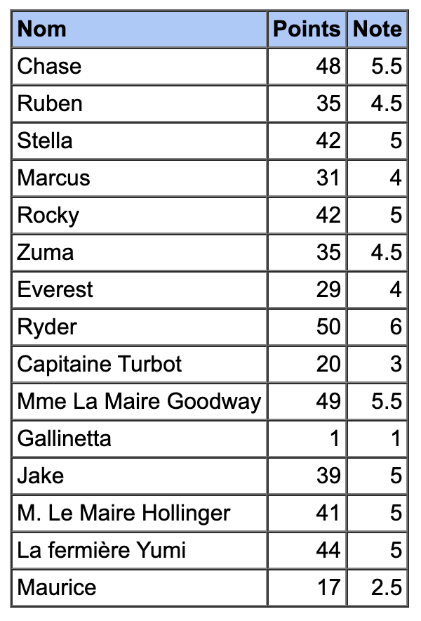
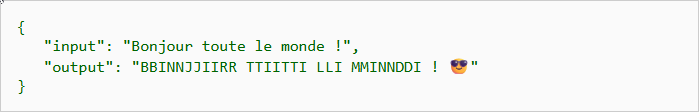
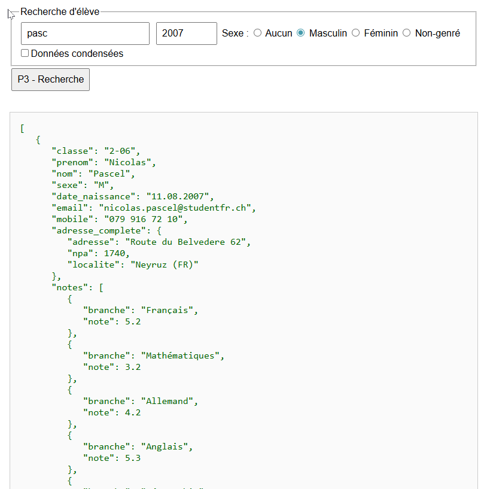
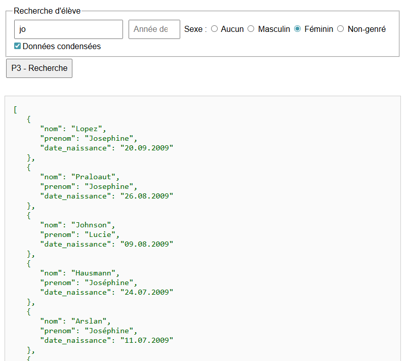

<h1><code>Module 323</code> - Programmer de manière fonctionnelle</h1>

# 😅 Exercice 07 - Pipe / Solution

## Objectifs

-   Entraîner les chaînages "pipes".

## P1 - Ajouter la note fédérale à toutes les évaluations effectuées

> [!IMPORTANT]
> Avant de poursuivre, documentez-vous d'abord sur les sujets suivants :
>
> -   Unary functions ⁉️
> -   Currying ⁉️
> -   Closure ⁉️
> -   Fonction "pipe" ⁉️

**⚠️ Vous allez devoir faire la même chose que dans l'exercice précédent, mais cette fois-ci en utilisant la fonction "pipe" ‼️**

Pour chaque étape du calcul de la note avec l'échelle fédérale, faites une fonction unaire. **Vous pourrez ensuite les appliquer toutes d'un coup**, avec la fonction "pipe" ‼️

Observez avec attention [les données sur des examens réalisés](/src/ex07-data-examens.js). Il s’agit d’une liste de points obtenus à un examen de chaque étudiant d’une classe.

Ajouter la note obtenue à chaque étudiant en respectant l’**échelle fédérale** :

-   on divise le nombre de point obtenus par le nombre de points total de l’épreuve
-   on multiplie ce nombre par 5
-   on ajoute 1
-   on arrondit au demi-point

Constituer le tableau HTML montrant les examens réalisés avec la note officielle. Vous devriez obtenir ceci :

## P2 - Traducteur loufoque

### But de l’exercice

Écrire du code qui **traduit** le texte saisi dans une zone de texte vers un langage “farfelu” en **chaînant** des fonctions **unaires** (principe du _pipe_).

### Règles de transformation (dans cet ordre)

1. **Mettre en majuscules** toute la chaîne.
2. **Remplacer toutes les voyelles par `I`**.
3. **Doubler toutes les consonnes**.
4. **Ajouter l’émoji `😎` à la fin** de la phrase.

### Contraintes

-   Utiliser **exclusivement** des **fonctions unaires** (une entrée → une sortie).
-   Chaque étape doit être une **fonction pure** qui **prend une chaîne** et **retourne une chaîne**.
-   La traduction finale doit être obtenue en **composant** ces fonctions via un _pipe_ (pas d’effets de bord intermédiaires).
-   **Afficher** à l’écran la **phrase initiale** **et** la **phrase traduite**.

### Livrables attendus

-   Un **affichage** clair de :

    -   “input : …”
    -   “output traduit : …”

## P3 - moteur de recherche d’élèves avec **pipe** (composition de fonctions)

### But de l’exercice

Implémenter un **moteur de recherche d’élèves** en composant des **fonctions unaires** (principe du _pipe_). La recherche s’effectue sur :

-   un **champ unique** pour _nom ou prénom_ (confondu),
-   l’**année de naissance**,
-   le **sexe** (`M`, `F`, `N`),
-   une **case à cocher** pour l’**affichage condensé** des résultats.

### Contraintes

-   Toutes les **opérations de filtrage** et de **projection** sont des **fonctions unaires** (une entrée → une sortie), **pures** (sans effets de bord).
-   Le **pipeline** ne doit contenir **que** les fonctions correspondant aux champs **renseignés**.

    > Si un champ est vide/non coché, **sa fonction est exclue du pipe**.

-   L’UI doit afficher la **liste** (complète ou condensée).

### Bonus (optionnel)

-   Recherche **insensible aux espaces multiples** et aux **accents** (déjà amorcé par `normalize`).
-   **Tri** des résultats (ex. `nom` puis `prenom`) via une étape unaire supplémentaire optionnelle.
-   **Recherche en direct** (debounce) et **surbrillance** des correspondances dans l’affichage.
-   Message “**Aucun résultat**” ergonomique.

---

